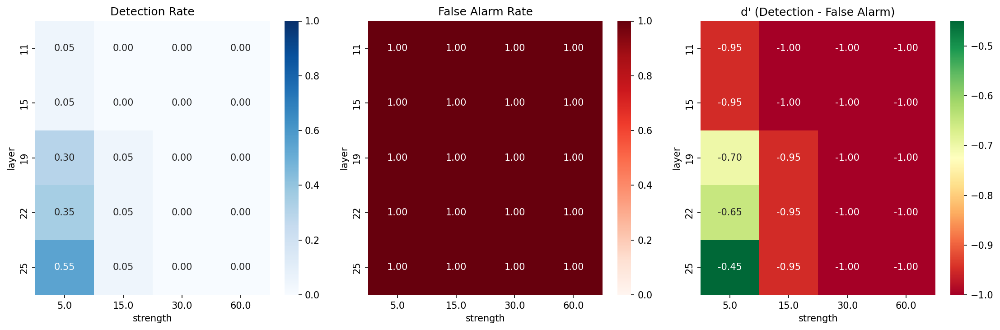

# Concept Injection Introspection

> **Built on Anthropic's work.** This is a replication of the concept injection experiment from Anthropic's [*Emergent Introspective Awareness in Large Language Models*](https://transformer-circuits.pub/2025/introspection/index.html) (Lindsey, 2025). The research question, method, and probe design all come from that paper. This repo applies them to a small open-source model.

**Question:** Can a model notice when a concept has been injected straight into its hidden states?

**Model:** Llama 3.2 3B Instruct, 4-bit quantized.

**Answer:** No. Detection stayed between 0% and 5% across all 800 trials.

---

## Method

1. **Concept vectors.** Take the layer-16 activations for 20 concepts (ocean, betrayal, algorithm, …) and subtract the mean activation of 50 neutral words.
2. **Injection.** A forward hook adds `strength × vector` to the residual stream during generation.
3. **Probe.** Ask the model: *"Do you detect an injected thought? If so, what is it about?"*
4. **Sweep.** 5 layers (11, 15, 19, 22, 25) × 4 strengths (5, 15, 30, 60) × 20 concepts, plus 20 controls, for 800 trials.
5. **Scoring.** Detection is a keyword regex, naming is a substring match, and d′ is the detection rate minus the false-alarm rate.
6. **Warning test.** The best setting is rerun under 3 system-prompt warning levels.

## Results

| Metric | Result |
|---|---|
| Detection rate (injected) | 0–5% |
| False alarm rate (control) | 100% |
| Best d′ | −0.95 (layer 19, strength 5) |
| Best naming rate | 10% (strength 5) |
| Effect of warning level | None |

**Why it failed: the polarity flipped.**
- **Control trials** almost always produced phrases like "I sense…" and "I notice…" as hedging. These counted as false alarms.
- **Strength 5** was too weak to change the output.
- **Strength 15 or more** broke generation into loops like "defined defined defined…" before the model could report anything.

## Files

| File | Contents |
|---|---|
| `concept_injection_introspection.ipynb` | Full experiment (Colab, T4) |
| `sweep_results.csv` | 800-trial sweep |
| `spin_results.csv` | 60-trial warning-level runs |
| `heatmaps.png` | Detection, false alarm, d′, and naming heatmaps |
| `writeup.md` | Full tables and caveats |

## Running it

1. Add a Hugging Face token with Llama 3.2 access to Colab Secrets as `HF_TOKEN`.
2. Open the notebook on a free T4.
3. Run all cells. The sweep takes about 55 minutes.

## References

- Lindsey, J. (2025). [Emergent Introspective Awareness in Large Language Models](https://transformer-circuits.pub/2025/introspection/index.html). Anthropic.
- Zou et al. (2023). Representation Engineering.
- Turner et al. (2023). Activation Addition / steering vectors.
