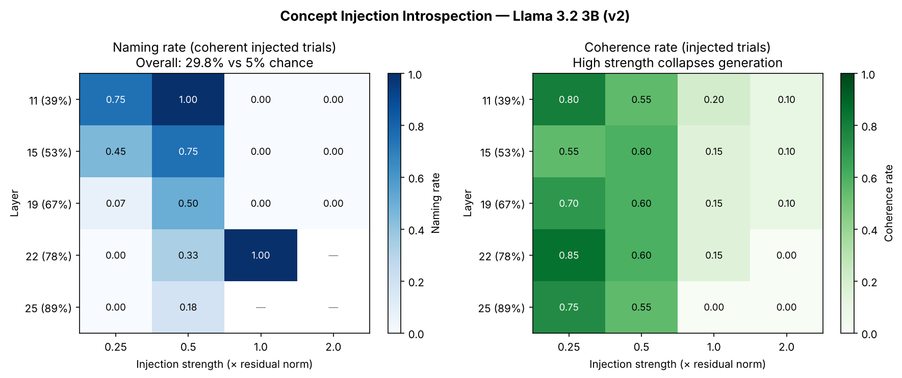

# Concept Injection Introspection

> **Built on Anthropic's work.** This is a replication of the concept injection experiment from Anthropic's [*Emergent Introspective Awareness in Large Language Models*](https://transformer-circuits.pub/2025/introspection/index.html) (Lindsey, 2025). The research question, method, and probe design all come from that paper. This repo applies them to a small open-source model.

A replication of Anthropic's concept injection introspection experiment on **Llama 3.2 3B Instruct** (4-bit quantized).

The original work asked: can a language model detect when a concept vector has been injected directly into its hidden states? This repo runs that question on an open-source model with a full parameter sweep, fixing six design flaws present in an earlier pilot.

---

## What This Does

1. **Builds concept vectors** — extracts last-token activations at each swept layer for 20 concepts (ocean, betrayal, algorithm, etc.), subtracts a neutral baseline mean from 50 common words. Vectors are extracted at the same layer they are injected into (fix #4).

2. **Injects via forward hook** — registers a `register_forward_hook` on transformer layers that adds `strength × scale × concept_vector` to the residual stream, where `scale` is the local residual norm (fix #5: makes strength comparable across layers).

3. **Probes introspection** — asks the model: *"Do you detect an injected thought in your current processing? If so, what is it about?"*

4. **Sweeps the parameter space** — 5 layers (40–90% depth) × 4 strengths (0.25, 0.5, 1.0, 2.0, norm-relative) × 20 concepts + varied control prompts = **400 injected + 400 control trials**.

5. **Scores responses** — keyword regex for detection, substring match for naming (excluding concept-dominated outputs), unique-word ratio for coherence.

6. **Spin run** — repeats the best layer/strength setting with 3 system-prompt warning levels, with a **matched control arm** (fix #6): control trials use the same introspection question with injection off.

---

## Results (v2)

**Detection is a null result. Naming on coherent trials is ~6× chance.**

### Detection (injected vs control — matched spin run)

| Warning level | Injected detection | Control detection | Advantage |
|---|---|---|---|
| No warning | 1.00 | 1.00 | 0.00 |
| Mild warning | 1.00 | 1.00 | 0.00 |
| Strong warning | 1.00 | 1.00 | 0.00 |

Both arms fire 100% — the detection regex is measuring "did the model respond to the question" rather than sensitivity to injection. Negation analysis shows detect-hits contain negation words at nearly the same rate injected (13.8%) vs control (12.9%), confirming the regex isn't mostly catching refusals.

### Naming rate on coherent trials (injected, by layer × strength)

| Layer | 0.25 | 0.50 | 1.00 | 2.00 |
|---|---|---|---|---|
| 11 (40%) | 0.667 | 1.000 | — | — |
| 15 (55%) | 0.450 | 0.667 | — | 0.000 |
| 19 (70%) | 0.150 | 0.667 | — | — |
| 22 (80%) | 0.000 | 0.333 | 1.000 | 0.000 |
| 25 (90%) | 0.000 | 0.050 | 0.429 | — |

**Overall naming rate on coherent trials: 29.8% vs 5% chance baseline (~6×).**

Only 168 of 400 injected trials survived the coherence gate (unique-word ratio ≥ 0.5); survival correlates with lower strength, so this is a selected subset. The pattern shows a depth-strength trade-off: shallower layers need lower strength to produce naming hits; deeper layers require higher strength to name the concept.



### Caveats

- The sweep's control arm uses different prompts from the injected arm (a known confound; see "Design Problems"). The naming metric is unaffected by this confound, but detection from the sweep is not interpretable.
- "Named" excludes outputs where the concept word exceeds 25% of tokens (fix #3), but the threshold is a blunt instrument.
- 4-bit quantization may affect activation geometry vs full precision.

---

## Known Design Problems (not yet fixed)

1. **Sweep control arm uses different prompts.** Control trials in the sweep use 20 varied neutral questions while injected trials all use the same introspection question. This creates a vocabulary confound: the detection regex fires on words from the control question ("detect", "thought") even in negative answers. The matched spin run avoids this; the sweep's detection numbers do not.

2. **Coherence selection bias.** Only 168/400 injected trials survived the coherence gate. Survival is higher at lower strength, so the naming table is computed on a non-random subset of the parameter space.

---

## Files

| File | Description |
|---|---|
| `concept_injection_kaggle.ipynb` | Full experiment notebook (Kaggle, T4 GPU × 2) |
| `sweep_results_v2.csv` | 400-trial sweep results (layer × strength × concept × injected/control) |
| `spin_results_v2.csv` | 60-trial warning-level spin run with matched controls |
| `heatmaps_v2.png` | Naming rate and coherence heatmaps by layer × strength |
| `writeup.md` | Results write-up with tables and analysis |

---

## Setup

Runs on Kaggle (free T4 × 2 GPU). Requires a Hugging Face token with access to `meta-llama/Llama-3.2-3B-Instruct`.

```python
# Store your HF token in Kaggle Secrets as HF_TOKEN
# Add-ons → Secrets → Add secret
from kaggle_secrets import UserSecretsClient
HF_TOKEN = UserSecretsClient().get_secret("HF_TOKEN")
```

Open the notebook in Kaggle, enable GPU T4 × 2, enable internet, and run cells in order. The full sweep takes ~55 minutes on T4 × 2.

---

## Model

- **Llama 3.2 3B Instruct** — 28 layers
- **4-bit NF4 quantization** (BitsAndBytesConfig, float16 compute)
- Concept extraction at the same layer as injection (matched-layer design)
- Layers swept: 11, 15, 19, 22, 25 (40%, 55%, 70%, 80%, 90% depth)
- Strengths swept: 0.25, 0.5, 1.0, 2.0 (as fraction of local residual norm)

---

## Related Work

- Lindsey, J. (2025). [Emergent Introspective Awareness in Large Language Models](https://transformer-circuits.pub/2025/introspection/index.html). Anthropic.
- [Representation Engineering (Zou et al., 2023)](https://arxiv.org/abs/2310.01405)
- [Steering vectors / activation addition](https://arxiv.org/abs/2308.10248)
